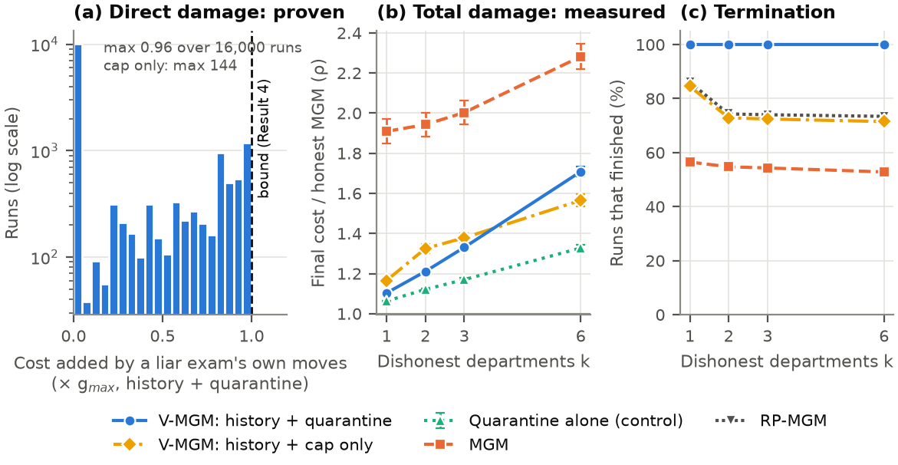
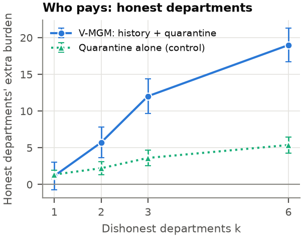
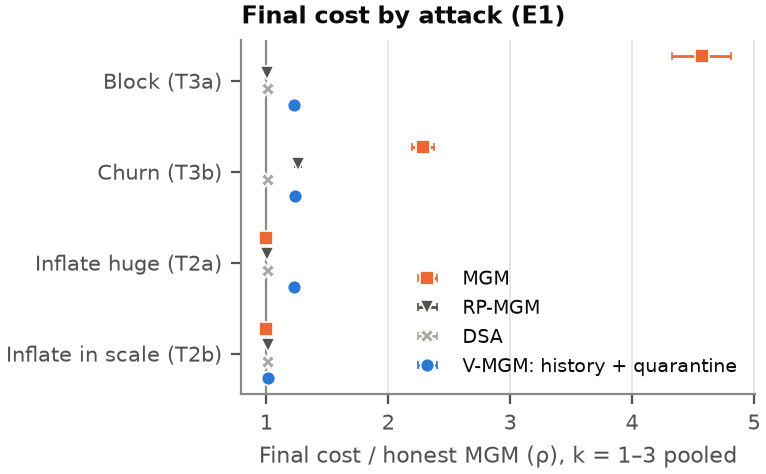
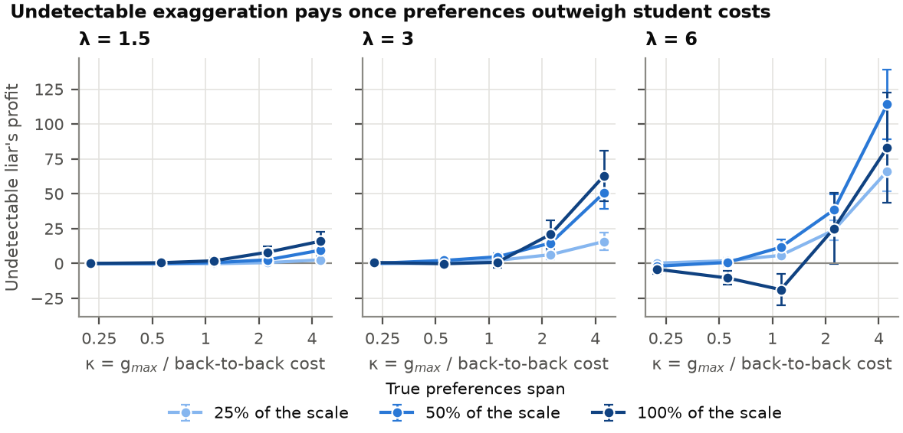
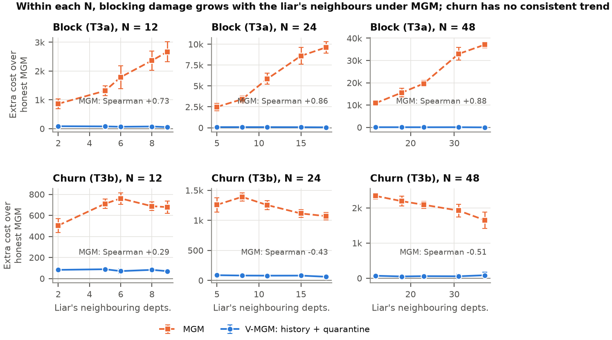
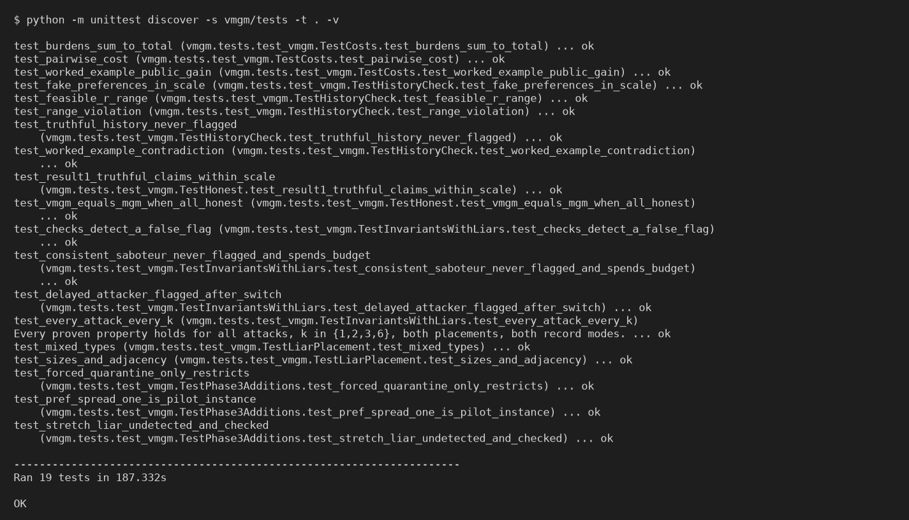
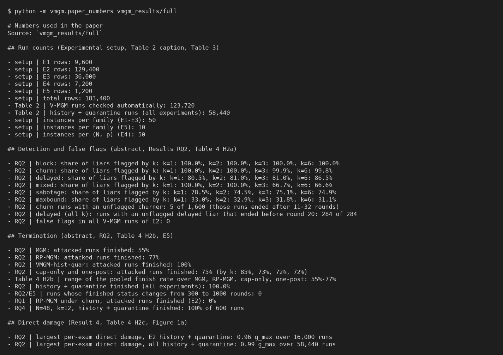

# Who Is Gaming the Timetable? Catching Dishonest Departments in Distributed Exam Scheduling

Multi-Agent Systems final project, IIT Gandhinagar.
Beli Dedhia, Khushi Garg, Ananya Patel, Poojan Soni.

**Report:** [paper/DCOP_v4.pdf](paper/DCOP_v4.pdf) (LaTeX source: [paper/DCOP_v4.tex](paper/DCOP_v4.tex))

## What this project does

Departments schedule their own exams with **MGM**, a distributed local-search algorithm: each round,
every department announces how much its best move would lower the total cost (its *gain*), and the
largest announcement among neighbours moves. MGM trusts these numbers, so a dishonest department can
announce a fake huge gain to grab turns, freeze its neighbours, or keep the search from ever finishing.

In exam timetabling most of a gain (student clashes and back-to-back exams) can be **recomputed by
anyone from public data**; only a department's own preference part is private, and it lies on a fixed
scale 0 to g_max. **V-MGM** (verified MGM) uses this:

* **History check:** every department keeps a running score per slot for each exam from the claims
  posted on the board, and flags a department whose claims contradict each other.
* **Priority cap:** no claim can count for more than the public gain + g_max.
* **Quarantine:** a flagged department may only make moves that lower the student cost.

With the history check and quarantine we **prove** that a liar's own moves add less than g_max of
student cost per exam, that every run finishes, and that the final cost is at most the starting cost
plus 2·g_max per dishonest exam. No bound relative to honest MGM is possible, so that is **measured**.

## Results

183,400 simulated runs (experiments E1–E5). Every V-MGM run (123,720) was checked automatically
against the proven results, with no violation.

| | Result |
|---|---|
| Detection, up to 6 of 12 departments dishonest | every blocker and 99.8–100% of churners flagged; **no honest department ever flagged** |
| Termination | history check + quarantine: **100%** of runs finished; MGM 55%, cap-only and one-post check 75% |
| Direct damage (proven < 1·g_max per exam) | largest **0.99·g_max** over 58,440 runs; cap-only reaches 144·g_max |
| Total cost vs honest MGM (measured) | ρ = 1.10 / 1.21 / 1.33 / 1.71 for k = 1 / 2 / 3 / 6, against 1.91–2.28 for MGM; about half of the excess is the cost of quarantine itself |
| Blocking attack | MGM 4.6× worse than honest play, V-MGM 1.2× |
| Undetectable lying | pays more as preferences grow relative to student costs (up to +114 at κ = 4.5) |

The three guarantees, kept apart (E2, k dishonest departments out of 12):



| Who pays for quarantine | Which algorithms lying hurts |
|---|---|
|  |  |

Undetectable lying pays once preferences outweigh student costs (E3):



Blocking damage grows with the liar's neighbours under MGM; V-MGM removes almost all of it (E4):



Unit tests and the number check (screenshots of the actual output):

| `python -m unittest ...` | `python -m vmgm.paper_numbers ...` (excerpt) |
|---|---|
|  |  |

## Reproduce the results

All commands run from the repository root. Python 3.10+.

```bash
pip install -r requirements.txt
python -m unittest discover -s vmgm/tests -t . -v      # 19 unit tests, about 4 minutes
```

The result files are already in [vmgm_results/full/](vmgm_results/full/). To regenerate everything:

| Step | Command | Output | Time |
|---|---|---|---|
| 1. Run E1–E5 (every run checked against the proofs) | `python -m vmgm.experiments all --seeds 50 --workers 7 --out vmgm_results/full` | `E1.csv`–`E5.csv` | about 1 h on 7 cores |
| 2. Statistics for every hypothesis | `python -m vmgm.analysis vmgm_results/full` | `vmgm_results/full/summary.md` | seconds |
| 3. Every number quoted in the paper | `python -m vmgm.paper_numbers vmgm_results/full` | `vmgm_results/full/paper_numbers.md` | seconds |
| 4. Figures 1–5, Tables 2 and 5 of the paper | `python -m vmgm.figures vmgm_results/full paper` | `paper/figures/`, `paper/tables/` | under a minute |
| 5. Compile the report | `cd paper && tectonic DCOP_v4.tex` (or upload `paper/` to Overleaf) | `paper/DCOP_v4.pdf` | about a minute |

Where each part of the report comes from:

| In the report | Generated by | Source data |
|---|---|---|
| Figure 1 (three guarantees) | `vmgm.figures` | E2 |
| Figure 2 (who pays for quarantine) | `vmgm.figures` | E2 |
| Figure 3 (lying vs algorithms) | `vmgm.figures` | E1 |
| Figure 4 (undetectable lying) | `vmgm.figures` | E3 |
| Figure 5 (damage vs neighbours) | `vmgm.figures` | E4 |
| Table 2 (proven vs measured) | `vmgm.figures` | E1–E5 |
| Table 5 (ρ by attack, k = 3) | `vmgm.figures` | E2 |
| Table 4 (hypotheses) and all numbers in the text | `vmgm.paper_numbers`, `vmgm.analysis` | E1–E5 |

## Repository layout

```
.
├── paper/
│   ├── DCOP_v4.tex, DCOP_v4.pdf   final report (compiles as is: arxiv.sty, references.bib included)
│   ├── figures/, tables/          generated by vmgm.figures
│   ├── response_to_reviewer.md    point-by-point answer to the project-review comment
│   └── archive/                   project-review version
├── vmgm/                          Python package (details: vmgm/README.md)
│   ├── model.py                   instances, costs, public gain
│   ├── attacks.py                 dishonest behaviours T1–T6
│   ├── protocol.py                MGM, V-MGM variants, RP-MGM, DSA
│   ├── invariants.py              automatic checks of the proven results on every run
│   ├── liars.py, metrics.py       liar placement; metrics
│   ├── experiments.py             E1–E5 runner
│   ├── analysis.py                statistics -> summary.md
│   ├── paper_numbers.py           every number in the paper -> paper_numbers.md
│   ├── figures.py                 figures and LaTeX tables
│   └── tests/                     unit tests
├── vmgm_results/full/             E1–E5.csv, summary.md, paper_numbers.md, full_run.log
├── docs/screenshots/              screenshots used in this README
└── PROJECT_CONTEXT.md             team handoff note: decisions and status
```

`vmgm/regression.py` reproduces the numbers of the earlier pilot code, which is not part of this
repository; it is not needed for any result in the report.
